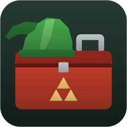
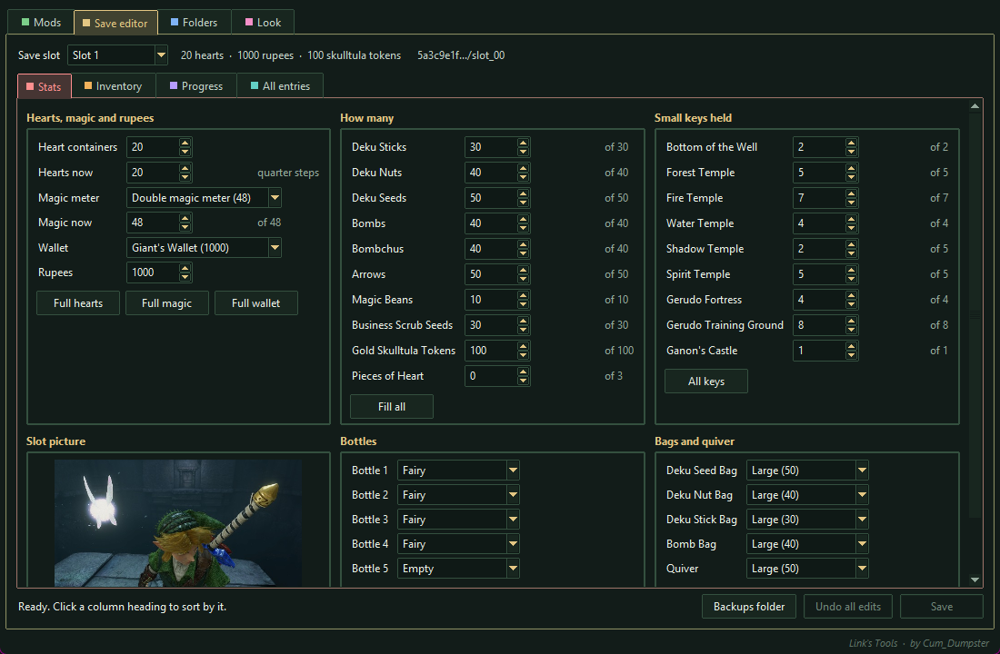
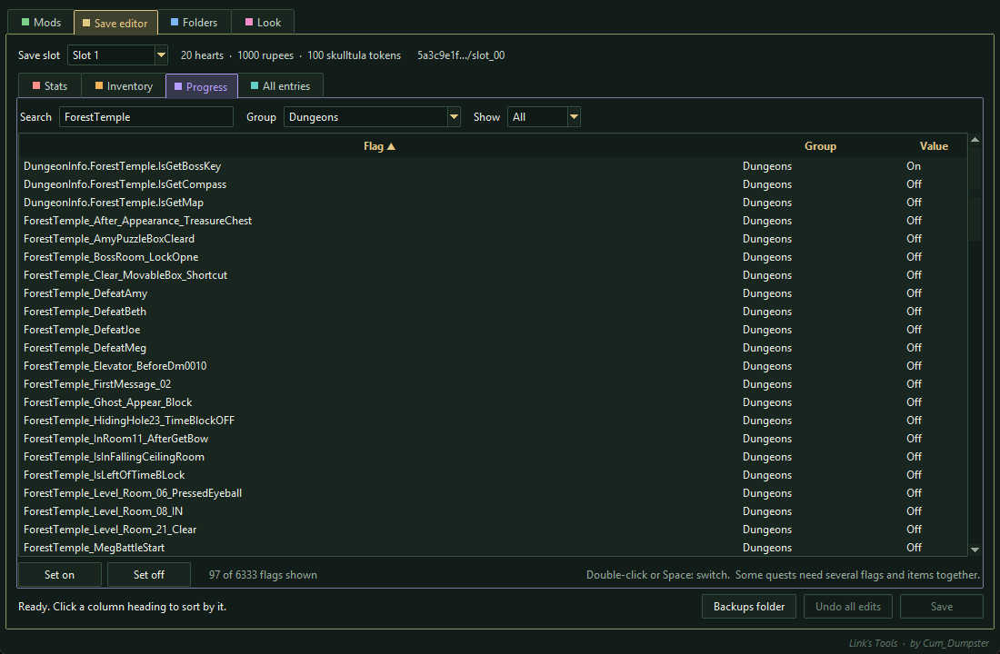
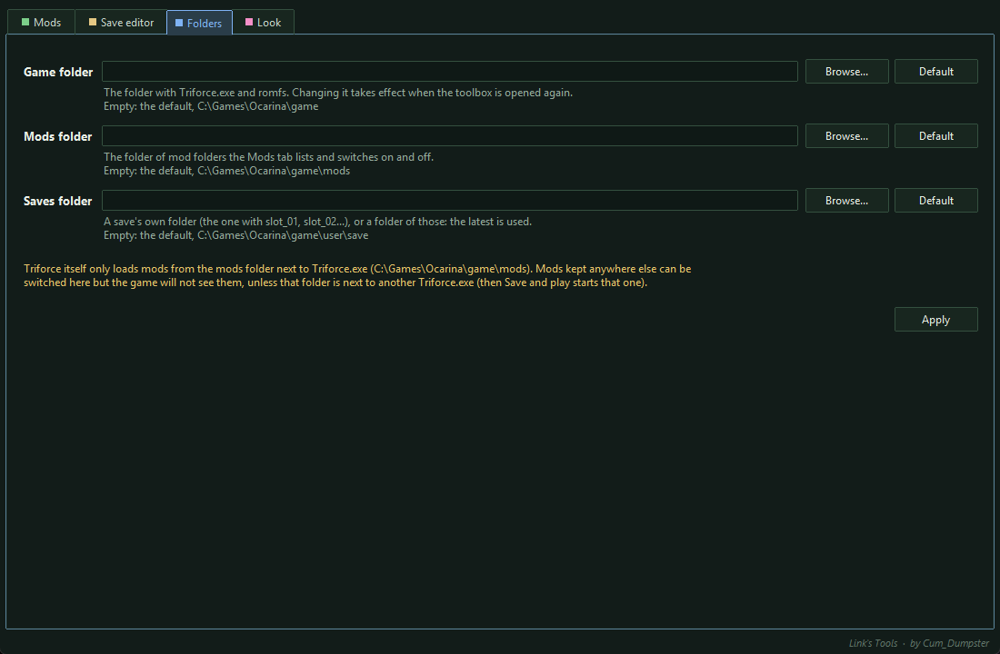
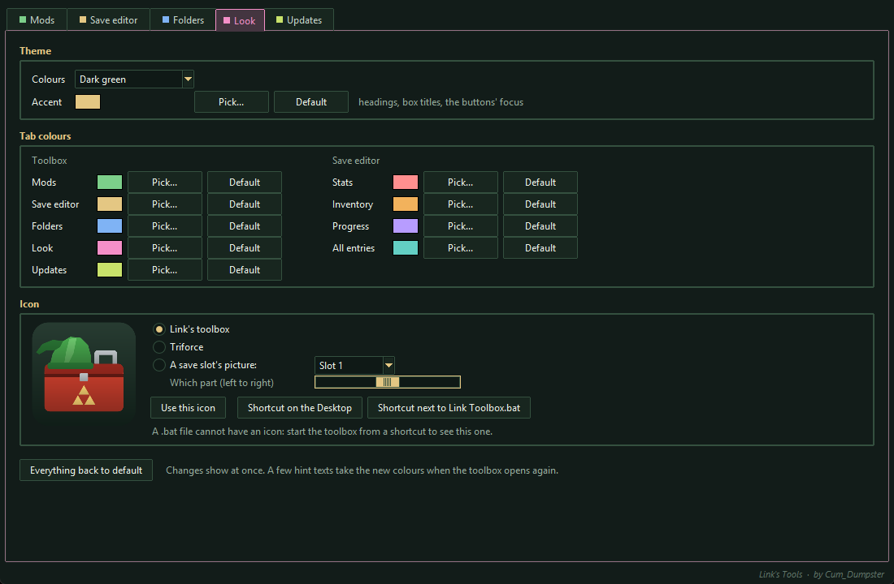
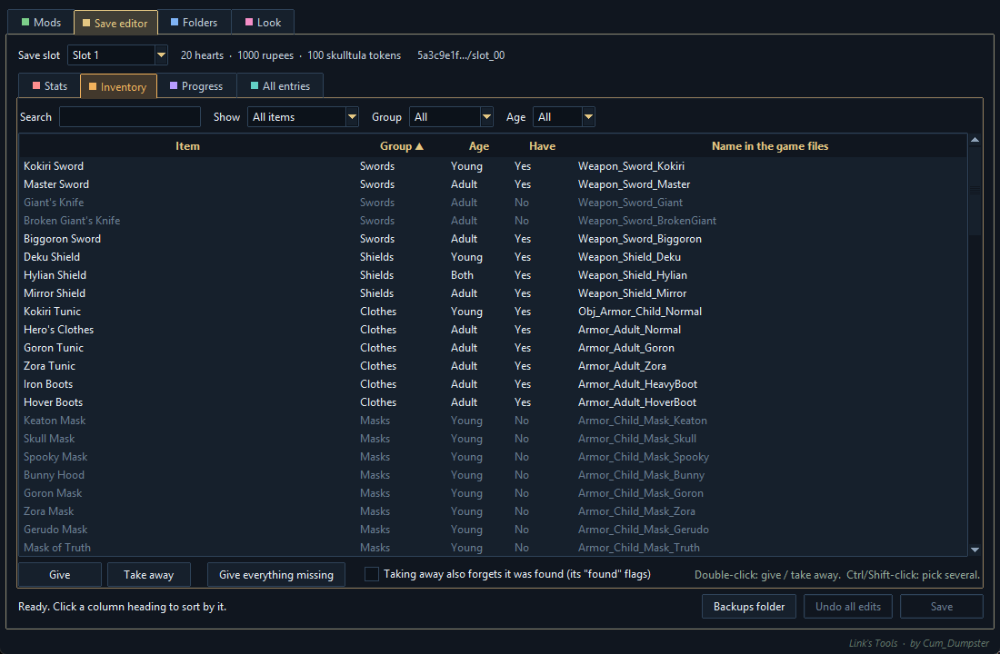

# Link's Toolbox

**Mod loader and save editor for *The Legend of Zelda: Ocarina of Time* on [Triforce](https://git.triforceproject.com/triforce/source)**, the PC port. It also works with [Longshot](https://git.magicbean.dev/MagicBeanDev/Longshot) (early support, since Longshot is still in development; see [Longshot](#longshot) below).

One small Windows app to switch your mods on and off before you play, and to edit your saves (hearts, magic, rupees, items, ammo, bottles, keys and story progress) using the names the game itself uses.



## Download

**Quickest (Windows):** paste this into PowerShell. It downloads the newest version and opens its installer (click **Install**, or **Upgrade** if it's installed already):

```powershell
irm https://raw.githubusercontent.com/losava/Links-Toolbox/main/install.ps1 | iex
```

Or get **`Link Toolbox.zip`** from the [Releases](../../releases) page, then use it either way:

- **Portable:** unzip it anywhere (even a USB stick) and double-click **`Link Toolbox.bat`**. Nothing is installed: to remove it, delete the folder.
- **Installed app:** double-click **`Install Link Toolbox.bat`** in the unzipped folder (details below).

**Install it (Windows):** in the unzipped folder, double-click **`Install Link Toolbox.bat`**. It installs the toolbox for you to `%LOCALAPPDATA%\Programs\Link Toolbox` (no admin needed), with Start menu and Desktop shortcuts, and an entry in **Windows Settings → Apps** to uninstall it. Running it again over an installed copy upgrades it and keeps your settings.

**Updates:** the **Updates** tab shows your version and checks GitHub for a newer one, by itself when the toolbox opens (you can turn that off) or with a button. It only tells you: nothing changes until you click **Update now**. That downloads the new version, closes the toolbox, puts it in place and reopens it, keeping your settings, backups, names lists and icon. This works for both the portable and the installed app.

**Uninstall (installed app):** the Updates tab's **Uninstall Link's Toolbox (this app)** button, or Windows Settings → Apps. It removes only the toolbox app, its shortcuts and its Apps entry, after asking first. The game, your game saves and your mods are not touched. For the portable copy, just delete its folder.

**Linux (new, untested):** get **`Link Toolbox (Linux).tar.gz`** instead, unpack it (`tar xzf "Link Toolbox (Linux).tar.gz"`) and open **`Link Toolbox.sh`**. It uses your system's Python, which must be **3.14 or newer with Tk** (`python3-tk`, `python3-tkinter` or `tk`). If either is missing, the script says what to install. It works best with Longshot's Linux build, whose saves are in `~/.local/share/longshot/save`. The slot picture needs Pillow, ImageMagick or ffmpeg. The Linux version hasn't been tried on a real Linux PC yet, so please report what works.

The first time, it also makes a **Link Toolbox** shortcut with the toolbox's icon next to the `.bat` file (a `.bat` can't have an icon of its own), so you can use that shortcut from then on. There's nothing to install: the zip brings its own Python. You need Windows 10 or 11 and a game built with Triforce (or Longshot). The toolbox finds the game where Triforce installed it, or asks you once for the folder that has `Triforce.exe` (or `longshot.exe`).

## Mods included

The zip comes with five mods in its `mods` folder. Install them from the **Mods** tab: click **Add mods...**, answer Yes, then press **Save**.

| Mod | What it does |
|---|---|
| Young Link Mirror Shield | Young Link holds the Mirror Shield in his hand |
| Young Link Hylian Shield | Young Link holds the Hylian Shield in his hand, like the Deku Shield |
| Young Link All Items | Young Link can pick the adult's items in the menu (big swords, Mirror Shield, hookshot...) |
| Biggoron One-Handed | The Biggoron Sword swung with one hand |
| Young Link Adult Motions | Young Link gets the adult's motions for the big swords, hookshot, bow and hammer |

They're made for **Ocarina of Time v131072** built with Triforce, and may not work on another version. Pressing Save also builds the size table (`~Size Table`) from your own game.

## Features

### Mods
- **Game** at the top picks whose mods you see: each game's `mods` folder (Triforce and NX2navi share one, Longshot has its own), plus any you keep from the Folders tab. Save and play starts that game.
- Lists every mod in that `mods` folder. Tick a mod to turn it on or off.
- Set the order: when two mods replace the same file, the lower one wins, and clashes are shown in red.
- **Save and play** starts the game with your choice.
- **Add mods...** copies mods in: the ones that come with the toolbox, or any folder you pick.
- Builds the shared size table Triforce needs for mods that make game files bigger (the `~Size Table` folder), every time you press Save.
- Won't change mods while the game is running.


### Save editor
Pick the **Game** whose saves you're editing (Triforce, NX2navi or Longshot: each keeps its own saves, and the top bar always shows which one and its folder), then a save slot. Each slot shows its summary and the picture the game took when you last saved.

| Tab | What you can do |
|---|---|
| **Stats** | Hearts (in quarter steps) and heart containers; magic meter and magic; wallet and rupees; **switch Link between young and adult**; bag and quiver sizes; ammo and counts; the five bottles and their contents; small keys for every dungeon. Quick buttons: Full hearts, Full magic, Full wallet, Fill all, All keys. |
| **Inventory** | All 104 items by their in-game names, with group and usual age. Give or take away items, pick several at once, or give everything missing. Won't take away equipped items. |
| **Progress** | More than 6,000 story flags (events, talks and Navi hints, dungeons, places, items found, mini-games...), searchable and filtered by group and state. |
| **All entries** | Every value in the slot's files, for advanced editing. |

Every list sorts by any column: click the heading, and click again to reverse. **Save and play** saves your edits and starts the game, with the mods as set in the Mods tab. **Save to...** writes the slot, with your edits, to every save location the toolbox finds (Triforce, NX2navi, Longshot, all ticked by default) and into any slot you pick, so one save can be the same in every game. What was there before goes to the backups.

**Switching age:** a save keeps Link's age in the map he's saved on. Outdoors, each area has a young and an adult map (`KakarikoVillage_Child` and `KakarikoVillage_Adult`), so **Switch to adult / young** moves him to the other age's map, together with the file-select screen and the save's "is a child" flag. Dungeons and houses have one map for both ages, so the editor asks you to save outside first.

**Stats**: hearts, magic, rupees, ammo, bottles, keys, bags and the slot picture


**Inventory**: give or take away any item, sorted and filtered by group, age and what you have


**Progress**: every story flag, here the Forest Temple's



**All entries**: every value in the save, by name


### Folders
**Games found** lists every game the toolbox finds, by app: Triforce, Longshot, and NX2navi (whose `ocarina.exe` can sit in the same folder as Triforce's). Pick one and press Apply: the toolbox reopens with that game's program for Save and play, its mods and its saves. Or set a different game, mods or saves folder by hand. Leave a box empty for the default. Folders you fill in by hand (ones the toolbox didn't find) are **kept as choices** if the Keep box is ticked: they show up in Games found, in the Mods tab's Game list and in the Save editor's Game list. The **Kept choices** list shows every kept folder, each with a **Forget** button to remove it.



### Look
Five themes (Dark green, Dark grey, Dark blue, Midnight purple, Light), an accent colour, and a colour for every tab. Changes show at once and are remembered.

**Icon:** Link's toolbox (the default), a Triforce, or a square cut from any save slot's picture (a slider picks which part). The icon is used on the window and the taskbar, and on the shortcuts, which you can also make on your Desktop.





## Longshot

[Longshot](https://git.magicbean.dev/MagicBeanDev/Longshot) is another PC port of the same game, by MagicBeanDev (a continuation of Hookshot). It loads mods by the same rules as Triforce: a `mods` folder in the game folder, a `romfs` folder in each mod, `_` or `-` at the start of a name turns a mod off, the mod whose name sorts last wins, and only one size table is used. That means the Mods tab, the included mods and the size table work with it too. Its saves have the same layout, so the save editor reads them as well.

**Longshot is still in development** (release candidates for now), so support here is early: anything Longshot changes may need a toolbox update.

To use it, open the **Folders** tab, set **Game folder** to Longshot's game folder (the one with `longshot.exe`, usually in `Games\Longshot` in your user folder), press **Apply**, then open the toolbox again. After that:

- **Mods:** in `mods` in that game folder.
- **Saves:** in `%APPDATA%\Longshot\save` when the game is started from Longshot's launcher, or in `user\save` in the game folder.
- **Save and play:** starts `longshot.exe`.
- If Triforce isn't installed, the toolbox finds Longshot's game folder by itself.

## Safety

- **Close the game before saving a save.** A running game writes over the save files when it saves.
- Every save first copies the old files into `app\backups\<date and time>\`. The **Backups folder** button opens it.
- Hearts, magic and rupees are written to both `progress.sav` and `caption.sav`, so the file-select screen matches.

## Run from source

The toolbox is plain Python with tkinter, and needs **Python 3.14 or newer** (for `compression.zstd`).

```bat
python toolbox.pyw
```

`mod_loader.pyw` and `save_editor.pyw` also open on their own. `python toolbox.pyw --selftest` opens every tab and closes again without writing anything.

To build the shareable zip (the scripts plus a copy of a Python 3.14 folder that has tkinter):

```bat
python make_share_zip.py --python "C:\path\to\python314"
```

It writes `share\Link Toolbox.zip`. Upload that to a GitHub release.

### Files

| File | What it is |
|---|---|
| `toolbox.pyw` | The main window: Mods, Save editor, Folders and Look tabs |
| `mod_loader.pyw` | The Mods tab |
| `save_editor.pyw` | The Save editor tab |
| `nxsave.py` | Reads and writes the save files, finds the game and saves, and reads entry names from the game files |
| `oot_catalog.py` | The item list, and where hearts, magic, rupees, bags, bottles and keys are kept in a save |
| `size_table.py` | Builds the size table for mods |
| `theme.py` | Themes and tab colours |
| `jpeg_win.py` | Turns the slot picture into PNG with Windows' own decoder |
| `icons.py` | Draws the icons, makes `icon.ico` from them or from a slot picture, and makes the shortcuts |
| `updater.py` | The Updates tab: checks GitHub's newest release, downloads it and puts it in place |
| `install.py` | Installs for this Windows user (shortcuts, Settings → Apps entry), and uninstalls |
| `install.ps1` | The one-line install: downloads the newest release and opens its installer |
| `make_share_zip.py` | Builds `Link Toolbox.zip` (and, with `--linux`, the Linux `.tar.gz`) |

The names of the save's entries aren't stored in this repository. The toolbox reads them from your own game files the first time and keeps them in `names-cache-<number>.json` (one for each game folder, so Triforce and Longshot each have their own).

## Credits

Link's Toolbox by **Cum_Dumpster**, released under the [MIT License](LICENSE).

Works with [Triforce](https://git.triforceproject.com/triforce/source) and [Longshot](https://git.magicbean.dev/MagicBeanDev/Longshot) (by MagicBeanDev and the Longshot contributors, a continuation of Hookshot by NotRexed). Neither is part of this project, and neither ships with it.

This is a fan-made tool, not affiliated with or endorsed by Nintendo. The source code in this repository contains no game files. The included mods are changed copies of a few game files, and are only in the release download. You need your own copy of the game.
