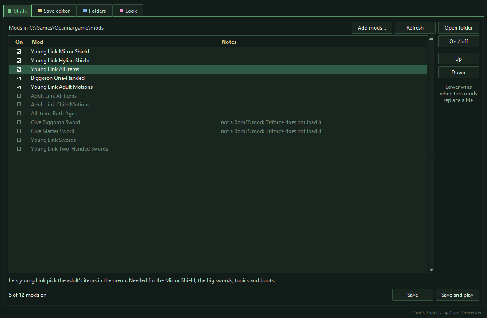
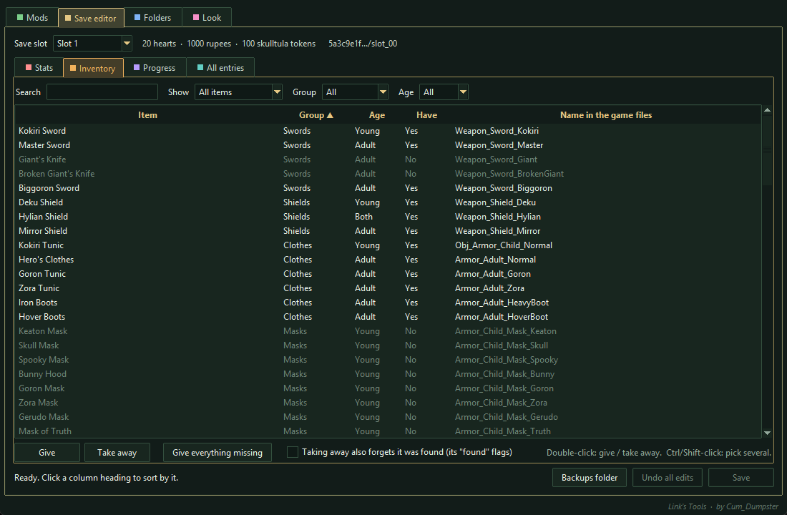
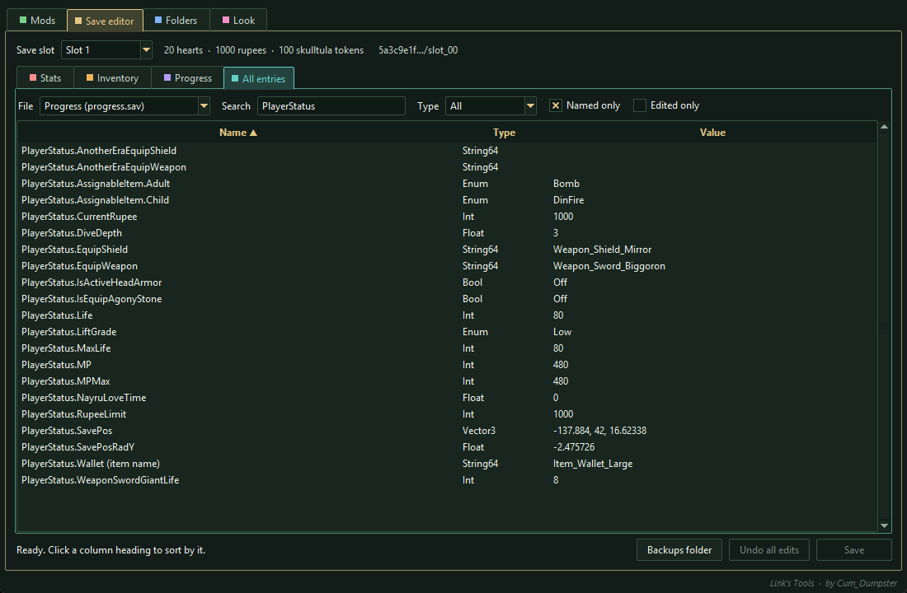

# Link's Toolbox

**Mod loader and save editor for *The Legend of Zelda: Ocarina of Time* on [Triforce](https://git.triforceproject.com/triforce/source)**, the PC port.

One small Windows app to switch your mods on and off before you play, and to edit your saves (hearts, magic, rupees, items, ammo, bottles, keys and story progress) using the names the game itself uses.


## Download

Get **`Link Toolbox.zip`** from the [Releases](../../releases) page, unzip it anywhere, and double-click **`Link Toolbox.bat`**.

There's nothing to install: the zip brings its own Python. You need Windows 10 or 11 and a game built with Triforce. The toolbox finds the game where Triforce installed it, or asks you once for the folder that has `Triforce.exe`.

## Mods included

The zip comes with five mods in its `mods` folder. Install them from the **Mods** tab: click **Add mods...**, answer Yes, then press **Save**.

| Mod | What it does |
|---|---|
| Young Link Mirror Shield | Young Link holds the Mirror Shield in his hand |
| Young Link Hylian Shield | Young Link holds the Hylian Shield in his hand, like the Deku Shield |
| Young Link All Items | Young Link can pick the adult's items in the menu (big swords, Mirror Shield, hookshot...) |
| Biggoron One-Handed | The Biggoron Sword swung with one hand |
| Young Link Adult Motions | Young Link gets the adult's motions for the big swords, hookshot, bow and hammer |

They're made for **Ocarina of Time v131072** built with Triforce, and may not work on another version. Pressing Save also builds the size table (`~Size Table`) from your own game.

## Features

### Mods
- Lists every mod in the game's `mods` folder. Tick a mod to turn it on or off.
- Set the order: when two mods replace the same file, the lower one wins, and clashes are shown in red.
- **Save and play** starts the game with your choice.
- **Add mods...** copies mods in: the ones that come with the toolbox, or any folder you pick.
- Builds the shared size table Triforce needs for mods that make game files bigger (the `~Size Table` folder), every time you press Save.
- Won't change mods while the game is running.



### Save editor
Pick a save slot. Each slot shows its summary and the picture the game took when you last saved.

| Tab | What you can do |
|---|---|
| **Stats** | Hearts (in quarter steps) and heart containers; magic meter and magic; wallet and rupees; bag and quiver sizes; ammo and counts; the five bottles and their contents; small keys for every dungeon. Quick buttons: Full hearts, Full magic, Full wallet, Fill all, All keys. |
| **Inventory** | All 104 items by their in-game names, with group and usual age. Give or take away items, pick several at once, or give everything missing. Won't take away equipped items. |
| **Progress** | More than 6,000 story flags (events, talks and Navi hints, dungeons, places, items found, mini-games...), searchable and filtered by group and state. |
| **All entries** | Every value in the slot's files, for advanced editing. |

Every list sorts by any column: click the heading, and click again to reverse.

**Stats**: hearts, magic, rupees, ammo, bottles, keys, bags and the slot picture


**Inventory**: give or take away any item, sorted and filtered by group, age and what you have



**Progress**: every story flag, here the Forest Temple's


**All entries**: every value in the save, by name



### Folders
Use a different game, mods or saves folder. Leave a box empty for the default.


### Look
Five themes (Dark green, Dark grey, Dark blue, Midnight purple, Light), an accent colour, and a colour for every tab. Changes show at once and are remembered.


## Safety

- **Close the game before saving a save.** A running game writes over the save files when it saves.
- Every save first copies the old files into `app\backups\<date and time>\`. The **Backups folder** button opens it.
- Hearts, magic and rupees are written to both `progress.sav` and `caption.sav`, so the file-select screen matches.

## Run from source

The toolbox is plain Python with tkinter, and needs **Python 3.14 or newer** (for `compression.zstd`).

```bat
python toolbox.pyw
```

`mod_loader.pyw` and `save_editor.pyw` also open on their own. `python toolbox.pyw --selftest` opens every tab and closes again without writing anything.

To build the shareable zip (the scripts plus a copy of a Python 3.14 folder that has tkinter):

```bat
python make_share_zip.py --python "C:\path\to\python314"
```

It writes `share\Link Toolbox.zip`. Upload that to a GitHub release.

### Files

| File | What it is |
|---|---|
| `toolbox.pyw` | The main window: Mods, Save editor, Folders and Look tabs |
| `mod_loader.pyw` | The Mods tab |
| `save_editor.pyw` | The Save editor tab |
| `nxsave.py` | Reads and writes the save files, finds the game and saves, and reads entry names from the game files |
| `oot_catalog.py` | The item list, and where hearts, magic, rupees, bags, bottles and keys are kept in a save |
| `size_table.py` | Builds the size table for mods |
| `theme.py` | Themes and tab colours |
| `jpeg_win.py` | Turns the slot picture into PNG with Windows' own decoder |
| `make_share_zip.py` | Builds `Link Toolbox.zip` |

The names of the save's entries aren't stored in this repository. The toolbox reads them from your own game files the first time and keeps them in `names-cache.json`.

## Credits

Link's Toolbox by **Cum_Dumpster**, released under the [MIT License](LICENSE).

This is a fan-made tool, not affiliated with or endorsed by Nintendo. The source code in this repository contains no game files. The included mods are changed copies of a few game files, and are only in the release download. You need your own copy of the game.
